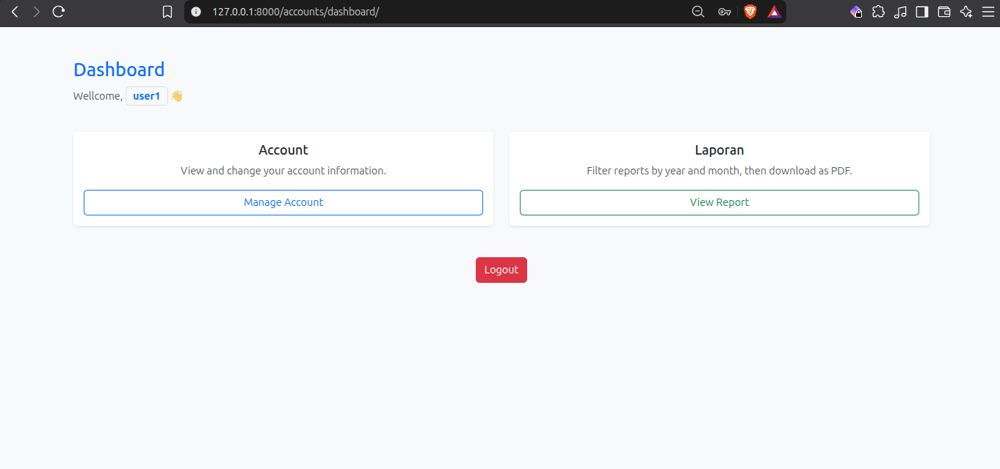
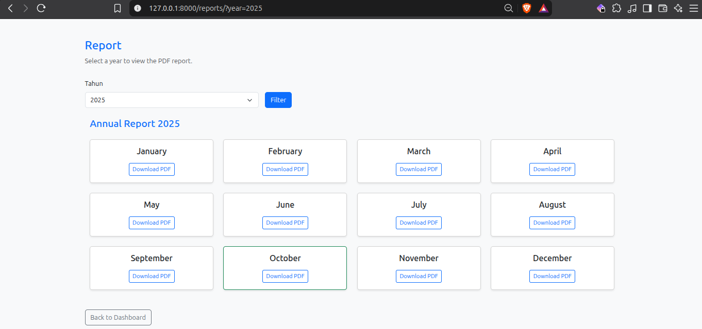
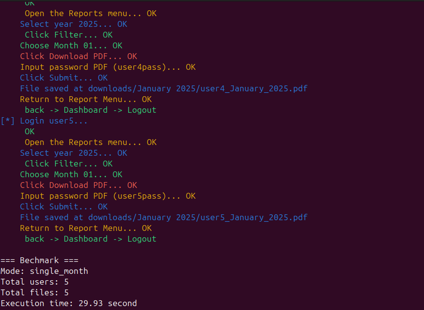
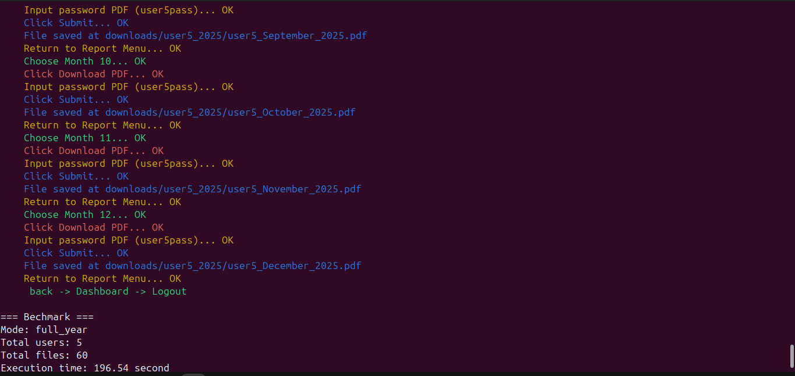

# RPA Simulation Tool (Django-Based)


> Created by **Fathir Afatar**

A conceptual simulation project demonstrating Robotic Process Automation (RPA) workflows—comparing manual data retrieval friction against automated CLI-driven script execution.

---

## 📌 Overview


This project is a **pure simulation** designed to model enterprise data extraction bottlenecks. It features a mock web portal built with the **Django Framework**, housing encrypted PDF reports and password lists. 

The primary goal is not commercial deployment, but to benchmark and demonstrate how manual multi-step browser interactions (login, report selection, year filtering, password entry, and downloading) can be completely bypassed using an automated script executed straight from the Command Line Interface (CLI).



---

## ⚡ Concept & Efficiency Comparison

| Step / Metric | Manual Web Navigation | Automated RPA Script |
| :--- | :--- | :--- |
| **User Interaction** | High (Login $\rightarrow$ View Report $\rightarrow$ Select year $\rightarrow$ Download on Month $\rightarrow$ Input PDF password $\rightarrow$ Download) | **Low (Single CLI command execution)** |
| **Time & Effort** | Repetitive manual clicking per file | **Instant batch retrieval** |
| **Error Rate** | Prone to typos, wrong clicks, or fatigue | **0% Human Error (Deterministic)** |

---

## 🛠️ System Architecture & Tech Stack

- **Backend:** Django Framework (used purely for routing, authentication simulation, and serving mock files).
- **Database:** SQLite3 (Default Django local database; **intentionally unused** as data is served statically via dummy assets).
- **Automation Interface:** Python CLI script simulating bot interactions.
- **Data Assets:** Strictly **dummy/synthetic data** (5 mock user accounts, password lists in Excel, and encrypted PDF files).

---

## 📂 Repository Structure

```text
├── download           # Results of download (.pdf file)
├── media/             # Dummy encrypted PDFs and sample Excel files (passwords)
├── rpa_core/          # Automation script / CLI bot logic
├── web_target/        # Django web application (mock target system)
├── requirements.txt   # Required Python packages
├── manage.py          # Django project management script
├── LICENSE            # Open-source MIT License
└── README.md          # Project documentation

```

---

## ⚠️ Important Disclaimer (Simulation Notice)

* **Synthetic Data Only:** All user accounts (limited to 5 mock profiles), passwords, and PDF reports included in this repository are **completely fake and generated solely for testing/simulation purposes**.
* **Proof-of-Concept:** This tool is built to study process efficiency, web scraping concepts, and RPA logic. It does not target any live or production systems.

---

## 🚀 Getting Started

### Prerequisites

* Python 3.x installed on your machine.

### Installation & Setup

1. **Clone the repository:**
```bash

cd rpa-simulation

```
2. Install virtual environement

```bash
python -m venv venv
source venv/bin/activate
```

3. **Install dependencies:**
```bash
pip install -r requirements.txt
```

4. **Run the Mock Django Web Server:**
```bash
python manage.py runserver
```

*(Note: The web portal hosts the mock login and target report files locally).*

5. **Execute the report and username Script (Via CLI)**
This code will generate 5 users and passwords, also the fake PDF file
```bash
python manage.py generate_reports
```

6. **Execute the RPA Simulation Script (via CLI):**
Open a separate terminal window and run the automation script to simulate automated authentication and batch downloading:

For one month report (e.g January = 1)
```bash
python manage.py robot_cli --mode=single_month --year=2025 --month=1
```
For one year report (e.g 2025)
```bash
python manage.py robot_cli --mode:full_year --year:2025
```

7. **If want to delete Username, Passwords, PDF**
```bash
python manage.py reset_dummy
```

---
## Results

> Each Process already set for 0,5 seconds. 5 users. Selected to download only for January 2025 reports only.


> Each Process already set for 0,5 seconds. 5 users. Selected to download only for whole 2025 reports.
---

## 🗺️ Roadmap & Future Enhancements

* [ ] Expand mock user profiles beyond the initial 5 test accounts.
* [ ] Add support for multi-threaded batch downloading to benchmark performance scaling.
* [ ] Implement headless browser automation logging for visual tracking.

---

## 📄 License

This project is open-source and released under the [MIT License](LICENSE). Free to use, modify, and study for educational purposes with attribution to **Fathir Afatar**.

---

## 💬 Contact & Feedback

Questions, academic discussions, or suggestions regarding RPA workflows are always welcome!

* Visit the [GitHub Repository](https://github.com/Fathir-Afatar/).
* If this conceptual simulation is interesting to you, please consider giving it a ⭐!
